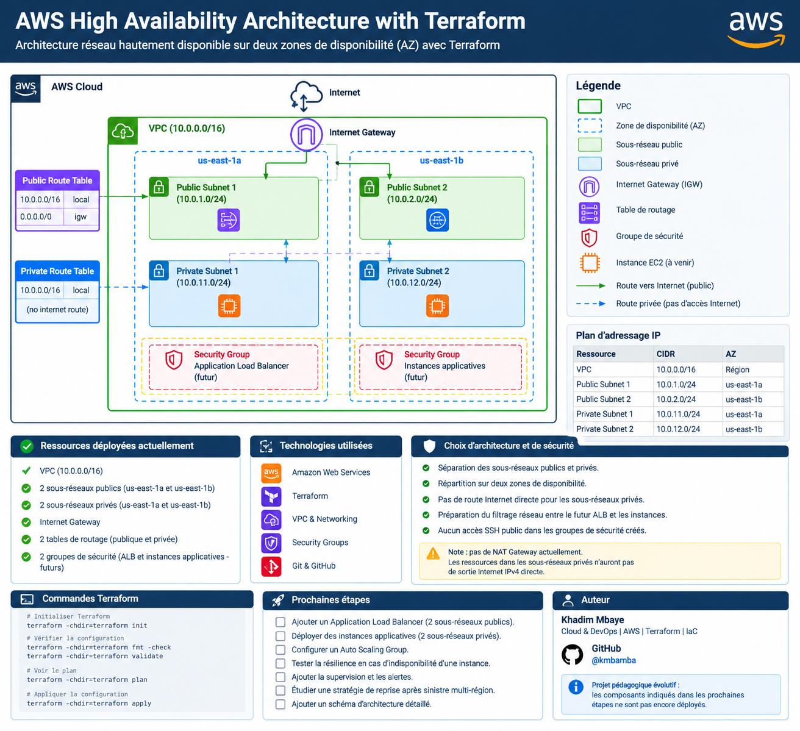

# AWS High Availability Architecture with Terraform

Infrastructure AWS hautement disponible déployée avec **Terraform**, répartie sur deux zones de disponibilité (*Availability Zones*) et conçue pour démontrer la distribution du trafic vers des instances applicatives privées.

## 🎯 Objectif du projet

Ce projet consiste à concevoir, provisionner et valider une infrastructure AWS reproductible à l'aide de l'Infrastructure as Code (IaC).

Il met en œuvre une architecture réseau segmentée, un Application Load Balancer public, un groupe Auto Scaling et deux instances EC2 réparties sur deux zones de disponibilité.

L'objectif est de mettre en pratique les principes de haute disponibilité, de sécurité réseau, d'automatisation et de gestion des ressources cloud.

## 🏗️ Architecture déployée



L'infrastructure comprend :

- **Amazon VPC** : réseau isolé avec le CIDR `10.0.0.0/16`.
- **Deux sous-réseaux publics** répartis sur deux zones de disponibilité.
- **Deux sous-réseaux privés** accueillant les instances applicatives.
- **Internet Gateway (IGW)** pour la connectivité Internet du sous-réseau public.
- **Tables de routage** séparées pour les sous-réseaux publics et privés.
- **Application Load Balancer (ALB)** public recevant les requêtes HTTP.
- **Target Group** assurant le suivi de l'état de santé des instances.
- **Launch Template** définissant la configuration des instances EC2.
- **Auto Scaling Group (ASG)** maintenant deux instances applicatives.
- **Security Groups** filtrant les flux entre le Load Balancer et les instances.

### Plan d'adressage IP

| Ressource | CIDR | Zone de disponibilité |
|---|---|---|
| VPC | `10.0.0.0/16` | `us-east-1` |
| Public subnet 1 | `10.0.1.0/24` | `us-east-1a` |
| Public subnet 2 | `10.0.2.0/24` | `us-east-1b` |
| Private subnet 1 | `10.0.11.0/24` | `us-east-1a` |
| Private subnet 2 | `10.0.12.0/24` | `us-east-1b` |

### Flux applicatif

1. Le client envoie une requête HTTP vers le DNS public de l'ALB.
2. L'ALB reçoit la requête sur le port 80.
3. Le Target Group oriente la requête vers une instance EC2 saine.
4. L'application renvoie une page indiquant le nom du serveur ayant traité la requête.

Les instances EC2 ne possèdent pas d'adresse IP publique. Leur trafic HTTP entrant est autorisé uniquement depuis le Security Group de l'ALB.

## 🛠️ Technologies utilisées

- **Cloud provider :** Amazon Web Services (AWS)
- **Infrastructure as Code :** Terraform
- **Compute :** Amazon EC2, Launch Template, Auto Scaling Group
- **Networking :** VPC, subnets, route tables, Internet Gateway
- **Load balancing :** Application Load Balancer, Target Group
- **Security :** Security Groups, segmentation réseau
- **Operating system :** Amazon Linux 2023
- **Version control :** Git et GitHub

## 🔐 Choix d'architecture et de sécurité

- Séparation des sous-réseaux publics et privés.
- Répartition des instances sur deux zones de disponibilité.
- Absence d'adresse IP publique sur les instances EC2.
- Filtrage du trafic applicatif : les instances acceptent le HTTP uniquement depuis l'ALB.
- Utilisation d'un Launch Template pour standardiser la configuration des instances.
- Utilisation d'un Auto Scaling Group pour maintenir la capacité configurée et remplacer les instances selon ses mécanismes de santé.

**Limites de cette version :**

- Le trafic entre le client et l'ALB utilise HTTP, sans HTTPS.
- Aucun NAT Gateway n'est déployé. Les sous-réseaux privés ne disposent donc pas de sortie Internet IPv4 via un NAT dans cette architecture.
- La supervision avancée, les alertes et les tests de reprise après panne restent à mettre en place.

## 🚀 Déploiement

### Prérequis

- Un compte AWS avec les autorisations IAM nécessaires.
- AWS CLI installé et configuré.
- Terraform installé.
- Git installé.

### 1. Cloner le dépôt

```bash
git clone https://github.com/kmbamba/aws-ha-architecture.git
cd aws-ha-architecture
```

### 2. Initialiser Terraform

```bash
terraform -chdir=terraform init
```

### 3. Formater et valider la configuration

```bash
terraform -chdir=terraform fmt -check
terraform -chdir=terraform validate
```

### 4. Prévisualiser les changements

```bash
terraform -chdir=terraform plan
```

### 5. Appliquer la configuration

```bash
terraform -chdir=terraform apply
```

Examine toujours le plan avant de confirmer l'application.

### 6. Récupérer le DNS de l'ALB

```bash
terraform -chdir=terraform output demo_alb_dns_name
```

Ouvre ensuite l'adresse HTTP correspondant au DNS retourné.

## 🧪 Vérifications effectuées

Les vérifications réalisées sur l'infrastructure déployée ont confirmé :

- Le provisionnement de l'infrastructure AWS avec Terraform.
- La disponibilité de l'application via l'Application Load Balancer.
- Dix requêtes HTTP successives retournant le statut `200`.
- La présence de deux instances EC2 saines dans le Target Group.
- La distribution observée du trafic entre les deux serveurs : cinq réponses provenant de chaque instance sur dix requêtes.
- La réussite du rafraîchissement des instances de l'Auto Scaling Group après une mise à jour du Launch Template.

Ces résultats valident le fonctionnement de base du Load Balancer et la répartition du trafic. Ils ne constituent pas encore un test de reprise après une panne réelle d'instance ou de zone de disponibilité.

## 💰 Gestion des coûts AWS

Ce projet est développé dans une optique d'apprentissage et de maîtrise des coûts.

- Aucun NAT Gateway n'est déployé.
- L'ALB et les instances EC2 peuvent générer des frais tant qu'ils fonctionnent.
- Des coûts additionnels peuvent s'appliquer aux volumes EBS, aux adresses IPv4 publiques, au transfert de données et à l'utilisation du Load Balancer.
- Vérifie les tarifs AWS, tes crédits disponibles et les estimations de coûts avant tout déploiement.

Après les tests, si l'infrastructure n'est plus nécessaire, vérifie le plan de destruction avant de supprimer les ressources :

```bash
terraform -chdir=terraform plan -destroy
terraform -chdir=terraform destroy
```

**Attention :** la destruction supprime les ressources gérées par l'état Terraform courant, notamment le VPC, les sous-réseaux, les tables de routage, les groupes de sécurité et les ressources applicatives. Ne l'exécute pas si tu souhaites conserver cette infrastructure.

## 🗺️ Évolutions possibles

- [ ] Ajouter HTTPS avec AWS Certificate Manager (ACM).
- [ ] Configurer CloudWatch pour la supervision et les alarmes.
- [ ] Tester le remplacement automatique d'une instance indisponible.
- [ ] Documenter les résultats d'un test de résilience.
- [ ] Étudier une stratégie de sauvegarde et de reprise après sinistre multi-région.
- [ ] Ajouter une pipeline CI/CD pour automatiser la validation Terraform.
- [ ] Renforcer la gestion des coûts et les contrôles de sécurité.

## Tests et validation

### 1. Répartition du trafic
- 10 requêtes HTTP consécutives envoyées via l'Application Load Balancer.
- Résultat : **10 réponses HTTP 200**.
- Les deux instances EC2 ont répondu chacune à 5 requêtes, confirmant la répartition du trafic entre les cibles.

### 2. Remplacement automatique d'une instance
- Terminaison volontaire d'une instance EC2 sans réduire la capacité désirée de l'Auto Scaling Group.
- L'Auto Scaling Group a conservé une capacité désirée de 2 instances.
- Après la transition, les deux instances étaient `InService` et `Healthy`.
- Le Target Group de l'ALB affichait les deux instances à l'état `healthy`.

### 3. Vérification après remplacement
- 10 nouvelles requêtes HTTP via l'ALB.
- Résultat : **10 réponses HTTP 200**.
- Les deux serveurs ont continué à répondre après le remplacement de l'instance.

**Conclusion :** les tests valident la répartition du trafic, le remplacement d'une instance EC2 par l'Auto Scaling Group et le maintien de l'accès HTTP à l'application après ce remplacement.


## 👨‍💻 Auteur

**Khadim Mbaye**  
Cloud & DevOps | AWS | Terraform | Infrastructure as Code

- GitHub : [@kmbamba](https://github.com/kmbamba)

---


*Projet pédagogique : l'architecture a été déployée et testée sur AWS. Les améliorations listées ci-dessus restent des évolutions possibles et ne sont pas présentées comme déjà réalisées.*